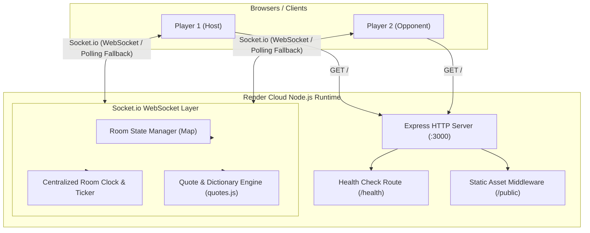
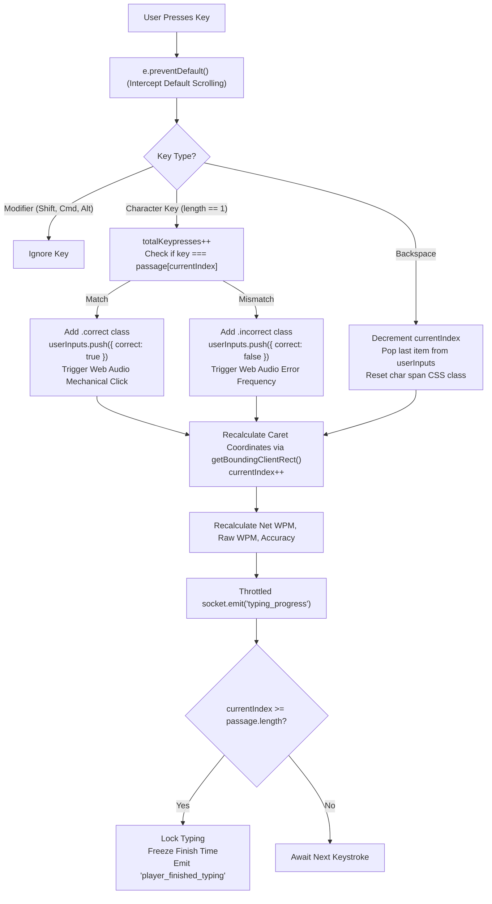
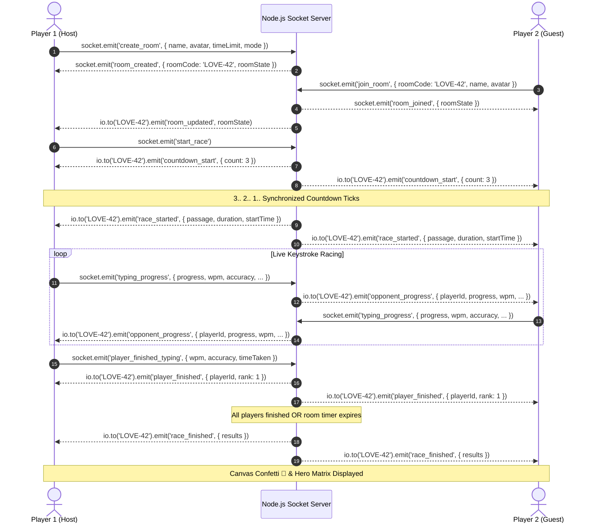

# 🏎️ TypeRacer Multiplayer — Technical Architecture & Engineering Documentation

A high-performance, real-time 1v1 multiplayer typing racer inspired by **Monkeytype's** distraction-free dark aesthetic and **TypeRacer's** competitive head-to-head racing mechanics.

Built specifically to deliver zero-latency typing, real-time opponent progress streaming, synchronized race starts, and mathematically precise WPM and accuracy metrics across the web.

Hosted live on **[Render](https://render.com)** as a unified, full-stack WebSockets service.

---

## 📑 Table of Contents
1. [Architecture Overview](#-architecture-overview)
2. [Directory & File Structure](#-directory--file-structure)
3. [The Typing Engine: Under the Hood](#-the-typing-engine-under-the-hood)
4. [Metrics & Mathematical Engine (The Final Matrix)](#-metrics--mathematical-engine-the-final-matrix)
5. [Multiplayer Protocol & Real-Time Synchronization](#-multiplayer-protocol--real-time-synchronization)
6. [Engineering Decisions & Technical Trade-Offs](#-engineering-decisions--technical-trade-offs)
7. [Audio Synthesis Subsystem (Web Audio API)](#-audio-synthesis-subsystem-web-audio-api)
8. [Production Deployment on Render](#-production-deployment-on-render)
9. [Local Development & Testing](#-local-development--testing)

---

## 🏗️ Architecture Overview

The application utilizes a **Unified Full-Stack Architecture**. A single Node.js runtime handles both static asset delivery (HTML, CSS, JS) and persistent, bidirectional WebSocket communication over a single HTTP port.



---

## 📁 Directory & File Structure

```
typeracergame/
├── package.json          # Project metadata, dependencies (express, socket.io, cors), npm scripts
├── package-lock.json     # Exact dependency lockfile
├── server.js             # HTTP server, Socket.io event router, room state lifecycle, graceful shutdown
├── quotes.js             # Curated literature/philosophy passage library & randomized word generator
├── README.md             # Comprehensive technical documentation & engineering manual
├── .gitignore            # Git exclusion rules (node_modules, .DS_Store, .env)
└── public/               # Client-side static frontend (served directly by Express)
    ├── index.html        # Single-page application markup (Lobby, Race, Overlays, Results Matrix)
    ├── style.css         # Monkeytype dark theme, JetBrains Mono font, caret animations, responsive layouts
    ├── game.js           # Client-side typing engine, caret math, socket client, modal presenter
    └── audio.js          # Hardware-accelerated Web Audio API sound synthesizer
```

### File Responsibilities
* **`server.js`**: Core backend daemon. Manages room dictionaries, broadcasts keystroke diffs, synchronizes start countdowns (3.. 2.. 1.. GO), handles disconnections/host migrations, and terminates gracefully on `SIGTERM`/`SIGINT`.
* **`quotes.js`**: Pure data & generation module. Contains long literary paragraphs (60–120+ words each) and a 300+ word pool. Exposes `getPassage(mode, duration)`.
* **`public/index.html`**: Zero-framework, semantic HTML containing 4 distinct interface states: Setup Lobby, Room Waiting Room, Active Race Track & Input Field, and the 4-column Hero Results Matrix.
* **`public/style.css`**: CSS variables defining the Monkeytype palette (`#323437`, `#e2b714`, `#646669`, `#ca4754`), flexbox/grid layouts, glowing animations, and hardware-accelerated caret transforms.
* **`public/game.js`**: Client-side state machine. Captures keystrokes, compares input character arrays against passage strings, calculates real-time net/raw WPM and accuracy, positions the cursor, and communicates with the server over WebSockets.
* **`public/audio.js`**: Procedural sound synthesis class using the browser's native `AudioContext`. Generates mechanical key clicks, error frequencies, countdown beeps, and harmonic victory chords without downloading external `.mp3` files.

---

## ⚡ The Typing Engine: Under the Hood

The client-side typing engine is engineered to match the precision of Monkeytype.



### 1. Keystroke Interception Architecture
Standard HTML `<input>` and `<textarea>` elements introduce native styling, mobile autocorrect artifacts, spellcheck red squiggles, and unpredictable selection ranges. 

Instead, the game uses a **Decoupled Input Model**:
* An invisible `<input type="text" id="hidden-input">` is placed offscreen with `autocorrect="off"`, `autocapitalize="off"`, and `spellcheck="false"`.
* The visual text is rendered inside a formatted `#words-container` where every single character in the passage is wrapped in an individual `<span class="letter" id="char-N">`.
* Clicking anywhere inside the container automatically shifts browser focus back to the hidden input. A global `window.keydown` listener redirects all valid alphanumeric inputs to the typing engine even if focus was momentarily lost.

### 2. Smooth Floating Caret Tracking
The caret cursor is an absolutely positioned `<div>` styled with a subtle vertical pulse animation:
```javascript
function updateCaretPosition() {
  const targetChar = document.getElementById(`char-${currentIndex}`);
  if (targetChar) {
    const charRect = targetChar.getBoundingClientRect();
    const containerRect = wordsContainer.getBoundingClientRect();

    caret.style.left = `${charRect.left - containerRect.left}px`;
    caret.style.top = `${charRect.top - containerRect.top}px`;
    caret.style.height = `${charRect.height}px`;
  }
}
```
By comparing `getBoundingClientRect()` of the active character against the container, the caret slides across lines automatically, handling font scaling, responsive line breaks, and variable character widths.

---

## 🧮 Metrics & Mathematical Engine (The Final Matrix)

Typing speed and accuracy are evaluated with exact mathematical rigor, preventing edge-case bugs like inflated counts on backspacing or division-by-zero errors.

### 1. State-Driven Integrity (Why Backspace Doesn't Break Metrics)
Previous typing implementations often maintained simple counters like `correctChars++`. When a user backspaced and re-typed a letter, `correctChars` would increment a second time, inflating their score.

TypeRacer uses an **Array-Backed State Model**:
* Every keypress appends an object: `userInputs[index] = { char: key, correct: (key === target) }`.
* When `Backspace` is pressed, `userInputs.pop()` removes the exact previous character state.
* The current state is always computed directly from the array:
  $$\text{correctChars} = \sum [u.\text{correct} == \text{true}]$$
  $$\text{incorrectChars} = \sum [u.\text{correct} == \text{false}]$$
* `totalKeypresses` tracks lifetime keystrokes (raw effort), while `userInputs` tracks current positional accuracy.

### 2. Formula Specifications

#### Net Typing Speed (WPM)
Standard international typing metric (1 word is defined as 5 keystrokes):
$$\text{Net WPM} = \max\left(0, \text{round}\left(\frac{\text{correctChars} / 5}{\Delta t_{\text{minutes}}}\right)\right)$$
Where:
$$\Delta t_{\text{minutes}} = \frac{\max(0.5, t_{\text{now}} - t_{\text{start}})}{60000}$$

#### Raw Typing Speed (Raw WPM)
Measures pure physical keystroke velocity without penalizing for typos:
$$\text{Raw WPM} = \max\left(0, \text{round}\left(\frac{\text{totalKeypresses} / 5}{\Delta t_{\text{minutes}}}\right)\right)$$

#### Typing Accuracy (%)
$$\text{Accuracy} = \begin{cases} 
100\% & \text{if } \text{totalKeypresses} = 0 \\
\text{clamp}\left(0, 100, \text{round}\left(\frac{\text{correctChars}}{\text{totalKeypresses}} \times 100\right)\right) & \text{otherwise}
\end{cases}$$

### 3. The 4-Column Hero Matrix
When the race ends, the user is presented with the Monkeytype Hero Matrix:

| Metric | Primary Display | Secondary Subtitle | Purpose |
| :--- | :--- | :--- | :--- |
| **WPM** | Large Golden Typography | `raw: <rawWpm>` | Net verified typing speed |
| **ACCURACY** | High-contrast `%` | `precision` | Overall keystroke correctness |
| **CHARACTERS** | Total Valid Chars | `<span color="#4ade80">Correct</span> / <span color="#ca4754">Errors</span>` | Character-by-character breakdown |
| **TIME** | Elapsed Seconds (e.g. `24s`) | `duration` | Test duration or completion time |

---

## 🌐 Multiplayer Protocol & Real-Time Synchronization

Real-time synchronization between geographically separated players is governed by **Socket.io WebSocket channels**.



### WebSocket Event Dictionary

| Event Name | Direction | Payload | Description |
| :--- | :--- | :--- | :--- |
| `create_room` | Client $\to$ Server | `{ playerName, avatar, timeLimit, mode }` | Initializes a room roomCode and sets caller as host |
| `join_room` | Client $\to$ Server | `{ roomCode, playerName, avatar }` | Validates room availability and registers new racer |
| `update_settings` | Client $\to$ Server | `{ timeLimit, mode }` | Host alters match rules (15s/30s/60s or quotes/words) |
| `toggle_ready` | Client $\to$ Server | `void` | Non-host racer signals readiness |
| `start_race` | Client $\to$ Server | `void` | Host triggers synchronized 3-second countdown |
| `countdown_tick` | Server $\to$ Client | `{ count }` | 1-second interval ticks with audio frequency beeps |
| `race_started` | Server $\to$ Client | `{ passage, duration, startTime, players }` | Unlocks input, supplies synchronized text passage |
| `typing_progress` | Client $\to$ Server | `{ progress, wpm, rawWpm, accuracy, ... }` | Emitted on keypress to update server state |
| `opponent_progress` | Server $\to$ Client | `{ playerId, progress, wpm, accuracy }` | Broadcast to competitors to animate racer avatars |
| `player_finished_typing` | Client $\to$ Server | `{ wpm, rawWpm, accuracy, correctChars, timeTaken }` | Locks player finish time, rank, and prevents drift |
| `race_finished` | Server $\to$ Client | `{ results, roomState }` | Final match termination; triggers confetti and stats |
| `play_again` | Client $\to$ Server | `void` | Resets player scores and returns room to lobby |

---

## 🛠️ Engineering Decisions & Technical Trade-Offs

### 1. Unified Full-Stack Service vs. Split (Vercel Frontend + Serverless Backend)
* **The Problem**: Platforms like Vercel and AWS Lambda operate on short-lived serverless functions. They do not maintain long-running TCP sockets required for WebSockets (`socket.io`). Splitting frontend to Vercel and backend to Railway/Render introduces Cross-Origin Resource Sharing (CORS) complexity, double deployment pipelines, and environment variable mismatch risks.
* **The Solution**: A unified Node.js architecture where Express serves static frontend files and mounts Socket.io on the identical HTTP listener. Zero CORS setup, zero environment variable requirements, and atomic single-commit deployments.

### 2. Procedural Web Audio API vs. Static `.mp3` Files
* **The Problem**: Serving static audio files (`click.mp3`, `beep.mp3`, `win.mp3`) increases HTTP request overhead, introduces network audio playback latency (which breaks the tactile feel of fast typing), and risks missing asset 404s.
* **The Solution**: Synthesizing sounds on-the-fly using the browser's hardware `AudioContext`.
  * Mechanical switch click: Exponential pitch-drop sine wave (300Hz $\to$ 120Hz in 40ms).
  * Error bump: Low-frequency sawtooth wave (150Hz $\to$ 110Hz in 80ms).
  * Victory fanfare: Polyphonic arpeggio across major triad frequencies ($C_5, E_5, G_5, C_6$).
  * Result: **0 KB audio network payload** and zero playback delay.

### 3. Vanilla JS DOM vs. React / Virtual DOM Overhead
* **The Problem**: Fast typists regularly exceed 120–160 WPM (10 to 15 keystrokes per second). In large virtual DOM frameworks, re-rendering an entire tree of 150+ character nodes on every single keystroke causes frame drops and typing stutter.
* **The Solution**: Direct targeted DOM manipulation. Only the specific `<span>` of the current character has its `classList` toggled, and the caret transform is updated via GPU-accelerated CSS properties (`left`, `top`).

---

## 🔊 Audio Synthesis Subsystem (`public/audio.js`)

All sound effects are synthetically produced in code:

```javascript
// Mechanical switch click simulation
playKeypress() {
  if (!this.enabled) return;
  this.init();

  const osc = this.ctx.createOscillator();
  const gain = this.ctx.createGain();

  osc.type = 'sine';
  const freq = 300 + Math.random() * 80; // Subtle pitch variation per keystroke
  osc.frequency.setValueAtTime(freq, this.ctx.currentTime);
  osc.frequency.exponentialRampToValueAtTime(120, this.ctx.currentTime + 0.04);

  gain.gain.setValueAtTime(0.12, this.ctx.currentTime);
  gain.gain.exponentialRampToValueAtTime(0.001, this.ctx.currentTime + 0.04);

  osc.connect(gain);
  gain.connect(this.ctx.destination);

  osc.start();
  osc.stop(this.ctx.currentTime + 0.04);
}
```

---

## 🚀 Production Deployment on Render

This codebase is production-ready and hosted on **Render** as a persistent Web Service.

### Render Configuration
* **Service Type**: Web Service
* **Runtime**: `Node`
* **Build Command**: `npm install`
* **Start Command**: `npm start`
* **Health Check Path**: `/health`
* **Environment Variables**: None required (automatically binds to `process.env.PORT`)

### Graceful Termination Handling
The server listens for POSIX termination signals from the host container orchestrator:
```javascript
process.on('SIGTERM', () => {
  console.log('SIGTERM signal received: closing HTTP server');
  server.close(() => process.exit(0));
});
```

---

## 🧪 Local Development & Testing

### Prerequisites
* **Node.js**: v18.0.0 or higher
* **npm**: v8.0.0 or higher

### Installation & Run
```bash
# Clone the repository
git clone https://github.com/SRB77/type-Racer.git
cd type-Racer

# Install production dependencies
npm install

# Start local server
npm start
```
Open **`http://localhost:3000`** in two separate browser tabs to test the 1v1 multiplayer race in real time.

---

### Instant Remote Tunneling (Without Cloud Deploy)
To test over the public internet with a remote player directly from your local terminal:
```bash
npm start
# In a second terminal:
npx localtunnel --port 3000
```
Share the generated `https://xxxx.loca.lt` URL with your partner to play immediately.

---

## 📝 License
MIT License. Built with love for real-time competitive typing. 💕
